<div align="center">
  
# 🪞 MongoMirror

# Customer Insights & Purchase Analytics Engine

## See Your Business as Data Sees It. 🧠

</div>


<p align="center">


</p>

---

# 📖 Project Description

**MongoMirror** is a customer and purchase analytics dashboard built using **Python, MongoDB, Pandas, Plotly, and Streamlit**. It transforms raw customer, product, and order records stored in MongoDB into interactive visualizations and business insights.

Instead of treating a NoSQL database as just storage, MongoMirror demonstrates how MongoDB can be combined with Python-based data processing to analyse sales performance, product revenue, customer spending, and order statuses through a clean, light-themed analytics dashboard.

Whether used by data analysts, students, or business teams exploring NoSQL analytics, MongoMirror simplifies purchase intelligence through an interactive, end-to-end workflow.

---

# ✨ Key Highlights

- 🗄️ MongoDB-Backed Analytics Dashboard
- 🔗 Python–MongoDB Integration via PyMongo
- 📊 Delivered Revenue & Order Metrics
- 📈 Monthly Revenue Trend Analysis
- 🏆 Top Products & Categories by Revenue
- 👤 Customer Spending Insights
- 🔁 Repeat Customer Analysis
- 📦 Order Status Distribution
- 🎛️ Date-Range & Category Filters
- ⚡ Cached Data Loading
- 🎨 Interactive Plotly Visualizations

---

# 🏗 System Architecture

MongoMirror follows a modular analytics pipeline that converts document-oriented records into interactive business insights through database retrieval, data processing, aggregation, and visualization.

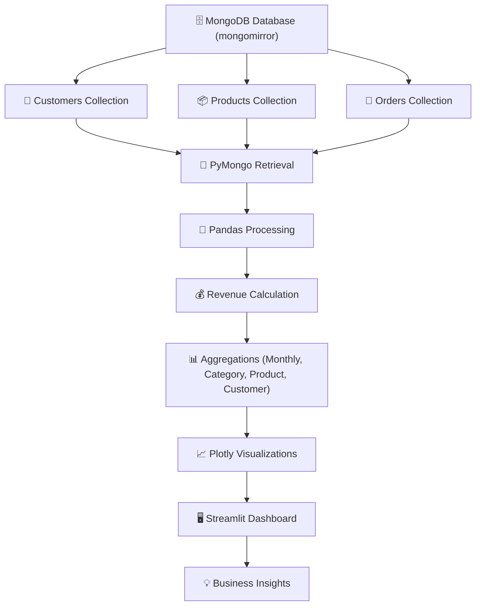

---

### 🔄 Application Workflow

1. Connect Python to the local MongoDB `mongomirror` database.
2. Retrieve customer, product, and order collections via PyMongo.
3. Merge records using customer and product IDs.
4. Calculate revenue per order (`Quantity × UnitPrice`).
5. Filter delivered orders for primary sales metrics.
6. Aggregate revenue by month, category, product, and customer.
7. Identify repeat customers within active filters.
8. Visualize results with Plotly charts.
9. Apply date-range and category filters.
10. Render the interactive Streamlit dashboard.
11. Deliver structured purchase insights to users.

---

# 📊 Feature Comparison

| Feature | Traditional Spreadsheet Review | MongoMirror |
|:---|:---:|:---:|
| NoSQL Data Storage | ❌ | ✅ MongoDB |
| Python–DB Integration | ❌ | ✅ PyMongo |
| Revenue Calculation | Manual | ✅ Automated |
| Monthly Revenue Trend | Manual | ✅ Interactive |
| Category Analysis | Manual | ✅ Interactive |
| Product Ranking | Manual | ✅ Automated |
| Customer Spending | Manual | ✅ Automated |
| Repeat Customer Count | Manual | ✅ Filter-Aware |
| Order Status View | ❌ | ✅ Visual |
| Interactive Dashboard | ❌ | ✅ Streamlit + Plotly |

---

# ✨ Core Features

## 🗄️ Database Design

Three MongoDB collections power the dashboard:

**Customers** — `customer_id`, `name`, `email`, `city`, `joined_at`

**Products** — `product_id`, `name`, `price`, `category`

**Orders** — `order_id`, `customer_id`, `product_id`, `quantity`, `unit_price`, `order_date`, `status`

*Sample dataset: 20 customers, 15 products, 40 orders (synthetic, for portfolio demonstration).*

---

## 💰 Revenue Calculation

- Revenue per order = `Quantity × UnitPrice`
- Primary metrics use **delivered orders only**
- Pending, cancelled, and returned orders excluded from sales metrics

---

## 📈 Monthly Revenue Analysis

- Order dates converted to monthly periods
- Delivered revenue aggregated by month
- Reveals changes in sales performance over time

---

## 🏆 Product & Category Performance

- Products ranked by revenue and units sold
- Categories compared by delivered revenue contribution
- Distinguishes high-value products from high-volume ones

---

## 👤 Customer Spending Analysis

- Delivered orders grouped by customer
- Total spending calculated per customer
- Top customers identified by revenue contribution

---

## 🔁 Repeat Customer Analysis

- Customers with **2+ delivered orders** counted as repeat customers
- Measured within active dashboard filters
- Does not establish long-term retention

---

## 📦 Order Status Analysis

- Orders grouped by status
- Visualizes distribution of delivered, pending, cancelled, and returned orders

---

## 🖥️ Dashboard Sections

**1. Overview** — KPIs, monthly revenue trend, category distribution, top 5 products, top 5 customers

**2. Sales Analytics** — Revenue, delivered orders, AOV, monthly chart, summary table

**3. Product Insights** — Product metrics, top performers, performance table

**4. Customer Insights** — Active customers, repeat count, average spending, top spenders

**5. Order Status** — Status distribution and grouped counts

Includes date-range filters, category filters, Plotly interactivity, cached loading, and friendly empty states.

---

## 📊 Sample Dataset Insights

| Metric | Result |
|:---|:---|
| Total delivered revenue | ₹56,641 |
| Delivered order records | 33 |
| Units sold (delivered) | 59 |
| Products in database | 15 |
| Customers in database | 20 |
| Electronics revenue contribution | ~76.4% |

*These figures describe the demonstration dataset, not real-world performance.*

---

# 📸 Screenshots

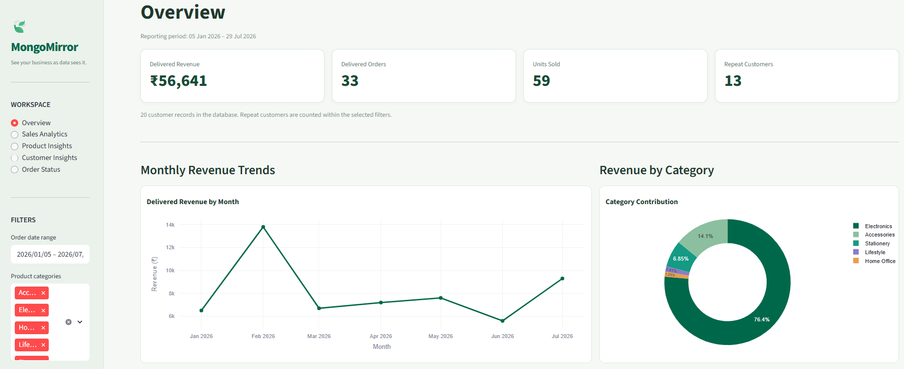
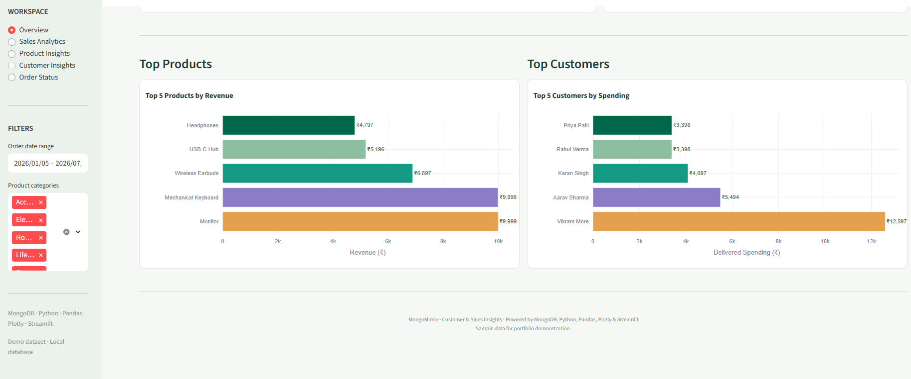
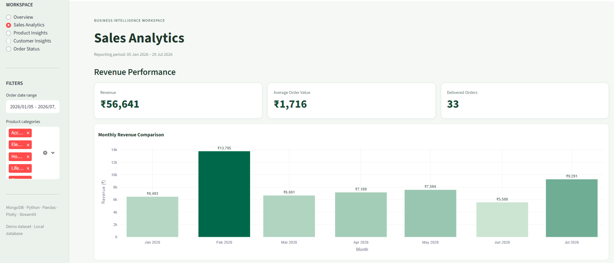
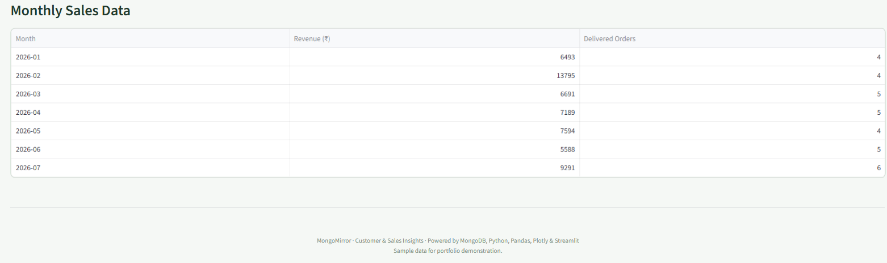
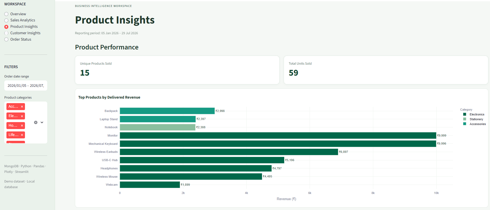
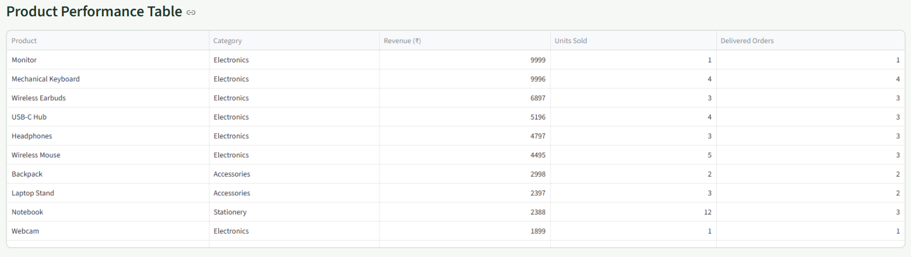
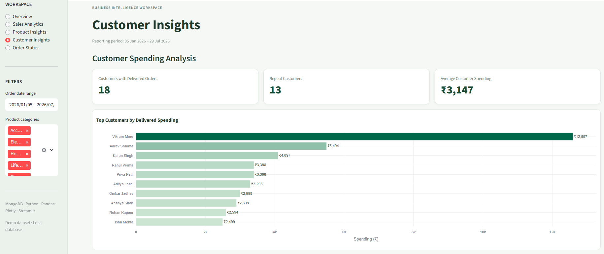
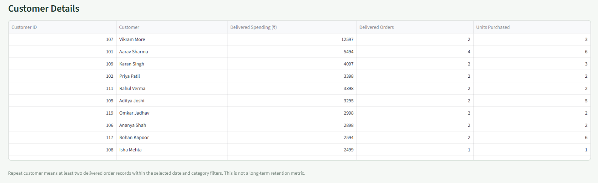
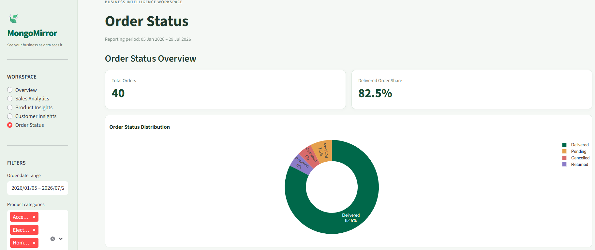
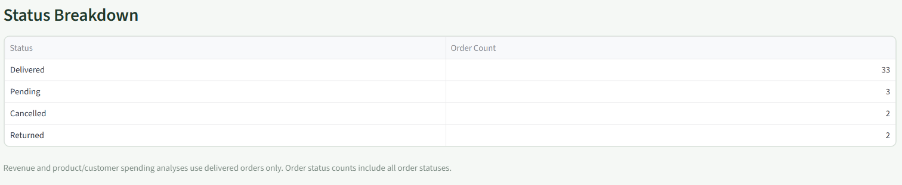


---

# 🛠 Technology Stack

| Layer | Technology |
|:---|:---|
| Programming Language | Python 3.11 |
| Database | MongoDB (NoSQL) |
| DB Driver | PyMongo |
| Data Processing | Pandas |
| Visualization | Plotly |
| Dashboard | Streamlit |
| Deployment | Local Streamlit Server |

---

# 📂 Project Structure

```text
MongoMirror/
│
├── main.py
├── dashboard.py
│
├── analytics/
│   └── monthly_revenue.py
│
├── screenshots/
│   ├── overview_dashboard.png
│   ├── sales_analytics.png
│   ├── product_insights.png
│   ├── customer_insights.png
│   └── order_status.png
│
├── requirements.txt
└── README.md
```

- `main.py` — Terminal monthly delivered-revenue summary
- `dashboard.py` — Streamlit dashboard with retrieval, filters, analytics, and visuals
- `analytics/monthly_revenue.py` — Reusable monthly revenue aggregation function

---

# ⚙ Installation

## Prerequisites

- Python 3.11+
- MongoDB Community Server (running locally)
- Populated `mongomirror` database

---

### Install Dependencies

```bash
pip install pymongo pandas plotly streamlit
```

---

### Run the Dashboard

```bash
python -m streamlit run dashboard.py
```

Open the local URL, typically: `http://localhost:8501`

---

### Run the Terminal Analysis

```bash
python main.py
```

Prints monthly delivered revenue, its percentage contribution, and total delivered revenue.

---

# 🚀 Demo Workflow

| Step | Action |
|:--:|:---|
| 1 | Start local MongoDB server |
| 2 | Launch the Streamlit dashboard |
| 3 | View Overview KPIs and trends |
| 4 | Apply date-range and category filters |
| 5 | Explore Sales Analytics and AOV |
| 6 | Review Product Insights and rankings |
| 7 | Analyse Customer Insights and repeat buyers |
| 8 | Inspect Order Status distribution |
| 9 | Run `main.py` for terminal revenue summary |
| 10 | Derive structured purchase insights |

---

# 🌟 Why MongoMirror?

Unlike conventional reporting that treats a database as a passive store, **MongoMirror** actively bridges NoSQL storage and interactive analytics. It retrieves document-oriented records, merges related collections, applies business rules, and surfaces insights through a clean, interactive dashboard.

MongoMirror enables analysts to calculate delivered revenue, track monthly trends, rank products and categories, identify top customers, and visualize order statuses — all within a single Streamlit workflow.

**MongoMirror doesn't just store your business — it reflects it back as insight.**

---

# 📚 Key Learnings

- Connecting Python applications to MongoDB using PyMongo
- Working with document-oriented data and related collections
- Combining customer, product, and order records for analysis
- Applying business rules to calculate revenue and sales metrics
- Aggregating transaction data by month, category, product, and customer
- Creating interactive dashboards with Streamlit and Plotly
- Translating raw transactional data into business-oriented visual insights

---

# ⚠️ Limitations

- The dataset is synthetic and intended for portfolio demonstration
- Repeat customer logic measures repeat purchasing, not long-term retention
- Metrics are based on delivered orders only
- The dashboard runs locally against a self-hosted MongoDB instance

---

# 🔮 Future Enhancements

| Phase | Features |
|:---|:---|
| Phase 1 | Automated Data-Quality Checks |
| Phase 2 | RFM Customer Segmentation |
| Phase 3 | Cohort-Based Retention Analysis |
| Phase 4 | Environment-Based MongoDB Configuration |
| Phase 5 | Automated Testing & CI/CD Deployment |
| Phase 6 | Cloud MongoDB Atlas Integration |
| Phase 7 | Predictive Sales Forecasting |
| Phase 8 | Enterprise Multi-Tenant Deployment |

---

# 🚀 Potential Applications

- 🛒 Retail Purchase Analytics
- 📊 NoSQL-Backed Business Intelligence
- 💼 Sales & Revenue Monitoring
- 🎓 NoSQL Analytics Learning & Portfolio Building
- 🏢 Customer Behaviour Analysis
- 📈 Product Performance Tracking
- 🔍 Order Fulfilment Insights

---

# 🎯 Advantages

- ⚡ Interactive and intuitive dashboard
- 🗄️ Real MongoDB integration
- 🧠 Business-rule-driven revenue metrics
- 📊 Multi-level aggregation insights
- 🎛️ Flexible date-range and category filters
- 📈 Plotly-based interactive charts
- 💻 Local, lightweight deployment

---

# 🛣 Roadmap

- ✅ MongoDB Database Design
- ✅ PyMongo Integration
- ✅ Revenue Calculation Logic
- ✅ Monthly Revenue Analysis
- ✅ Product & Category Performance
- ✅ Customer Spending Insights
- ✅ Order Status Visualisation
- ✅ Streamlit + Plotly Dashboard
- 🔄 RFM Segmentation
- 🔄 Cohort Retention Analysis

---

# 👩‍💻 Developer

## Keya Das

**MCA (Artificial Intelligence & Data Science)**

🌐 **GitHub**

https://github.com/Keya3639

📧 **Email**

keyakarunamoydas@gmail.com

---

# 🙏 Acknowledgements

This project was developed using the following open-source technologies:

- 🐍 Python
- 🍃 MongoDB
- 🔗 PyMongo
- 🐼 Pandas
- 📈 Plotly
- 🎨 Streamlit
- 🌍 Open Source Community

---

<div align="center">

# 🪞 MongoMirror

### See Your Business as Data Sees It. 🧠

<br>

**Built with ❤️ using**

**Python • MongoDB • PyMongo • Pandas • Plotly • Streamlit**

<br>

</div>
